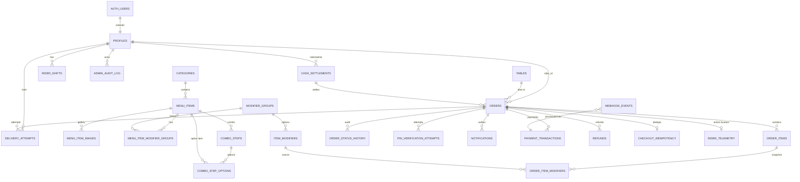
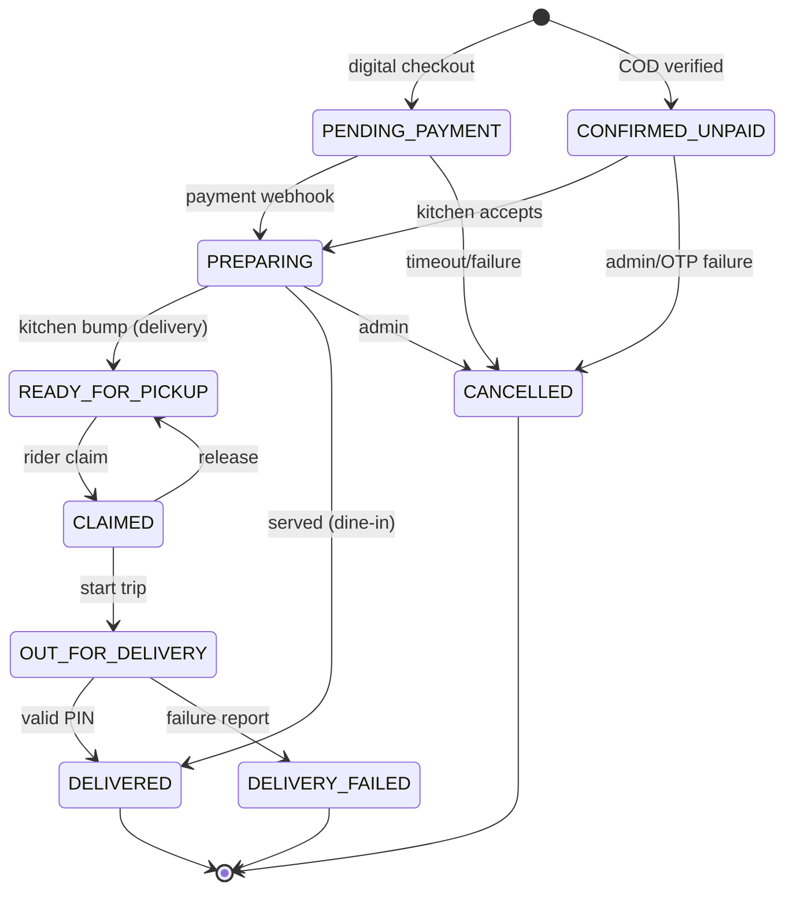

# ERD AND DATA DICTIONARY

| Field | Value |
| :--- | :--- |
| **Status** | Approved v1.1 data model |
| **Version** | 1.1.0 |
| **Date** | 2026-10-29 |
| **Source of truth** | `supabase/migrations/20261029000000_initial_schema.sql` |

---

## 1. Entity Relationship Diagram

---

## 2. Table Groups

### 2.1 Identity and staff

| Table | Purpose |
| :--- | :--- |
| `auth.users` | Supabase-managed staff credentials (synthetic email + 6-digit PIN as password). |
| `profiles` | Staff/rider profile and role. Customer accounts are not required. |

### 2.2 Menu

| Table | Purpose |
| :--- | :--- |
| `categories` | Menu sections. |
| `menu_items` | Dishes, drinks, combos, and hidden combo components. |
| `menu_item_images` | Optional gallery. `menu_items.image_url` remains the primary image. |
| `modifier_groups` | Groups with selection rules. |
| `item_modifiers` | Options inside a group. |
| `menu_item_modifier_groups` | Which groups apply to which items. |
| `combo_steps` | Combo builder steps. |
| `combo_step_options` | Allowed option per step. |

### 2.3 Orders and fulfilment

| Table | Purpose |
| :--- | :--- |
| `tables` | Dine-in tables and signed QR tokens. |
| `orders` | Master order record. |
| `order_items` | Immutable line-item snapshot. |
| `order_item_modifiers` | Immutable modifier snapshot. |
| `order_status_history` | Every status transition with actor. |
| `pin_verification_attempts` | Handover PIN audit. |
| `delivery_attempts` | Success/failure outcomes. |
| `rider_telemetry` | Latest location per rider. |
| `rider_shifts` | Shift and float boundaries. |
| `cash_settlements` | End-of-day cash reconciliation. |

### 2.4 Payments and notifications

| Table | Purpose |
| :--- | :--- |
| `payment_transactions` | Gateway truth. |
| `webhook_events` | Idempotency and replay audit. |
| `refunds` | Refund lifecycle. |
| `checkout_idempotency` | Duplicate checkout prevention. |
| `otp_verifications` | COD/staff OTP hashes. |
| `blacklisted_phones` | COD abuse prevention. |
| `notifications` | SMS outbox. |

### 2.5 Audit and settings

| Table | Purpose |
| :--- | :--- |
| `app_settings` | Singleton operational settings. |
| `settings_history` | Settings changes. |
| `admin_audit_log` | Admin actions. |

---

## 3. Key Data Dictionary

### 3.1 `orders`

| Column | Type | Notes |
| :--- | :--- | :--- |
| `id` | UUID PK | `gen_random_uuid()`. |
| `order_number` | SERIAL UNIQUE | Human display (`#1042`). |
| `order_token` | UUID UNIQUE | Public capability token. |
| `order_type` | `order_type` | `DELIVERY` or `DINE_IN`. |
| `source` | `order_source` | `WEB`, `TABLE_QR`, `ADMIN`. |
| `customer_name` | TEXT | Required. |
| `customer_phone` | TEXT | As entered. |
| `customer_phone_normalized` | TEXT | E.164, trigger-normalized. |
| `table_id` / `table_number` | UUID / TEXT | Required for dine-in. |
| `delivery_latitude` / `delivery_longitude` | NUMERIC(10,7) | Required for delivery. |
| `road_distance_m` | INTEGER | OSRM metres. Precision-safe. |
| `items_subtotal` | INTEGER | Sum of base prices × qty. |
| `modifiers_total` | INTEGER | Sum of modifier deltas × qty. |
| `delivery_fee` | INTEGER | Calculated from metres. |
| `packaging_fee` | INTEGER | Delivery 1,000; dine-in 0. |
| `total_amount` | INTEGER | Enforced by trigger. |
| `payment_method` | `payment_method` | MoMo, Airtel, COD, card. |
| `payment_status` | `payment_status` | PENDING/PAID/FAILED/REFUNDED. |
| `payment_reference` | TEXT | Gateway reference. |
| `payment_transaction_id` | UUID | FK to `payment_transactions`. |
| `order_status` | `order_status` | FSM state. |
| `cod_change_requested_for` | INTEGER | Denomination. |
| `cod_change_due` | INTEGER | Computed. |
| `handover_pin` | CHAR(4) | Customer-only; column revoked from clients. |
| `failed_pin_attempts` | INTEGER | Persisted. |
| `pin_locked_until` | TIMESTAMPTZ | Lock window. |
| `security_flag` | TEXT | Admin alert. |
| `rider_id` | UUID | Assigned rider. |
| `customer_notes` | TEXT | Kitchen notes. |
| `kitchen_busy_buffer_applied` | INTEGER | Snapshot of buffer. |
| `customer_rating` | `feedback_rating` | GREAT/OKAY/BAD. |
| `eta_at` | TIMESTAMPTZ | Estimated arrival. |
| `estimated_travel_minutes` | INTEGER | OSRM duration + prep. |
| `settlement_id` | UUID | Cash settlement link. |
| `settled_at` | TIMESTAMPTZ | Cash settled. |
| `cancelled_at` / `cancellation_reason` / `cancelled_by` | | Cancellation audit. |
| `admin_edited_at` / `admin_edited_by` | | Admin edit audit. |
| `version` | INTEGER | Optimistic concurrency. |
| `acknowledged_at` | TIMESTAMPTZ | Kitchen acknowledgement. |
| `created_at` / `claimed_at` / `dispatched_at` / `delivered_at` / `updated_at` | TIMESTAMPTZ | Lifecycle. |

### 3.2 `app_settings`

Singleton row (`id = 1`). Includes:

- Restaurant name, coordinates, support WhatsApp.
- `free_delivery_radius_km` (5.0), `rate_per_excess_km` (1,500), `max_delivery_radius_km` (15.0), `cod_max_radius_km` (8.0).
- `minimum_order_value` (20,000), `minimum_order_value_dine_in` (0).
- `packaging_fee_default` (1,000), `packaging_fee_dine_in` (0).
- `is_store_open`, `opening_time`, `closing_time`, `timezone`.
- `is_kitchen_busy`, `busy_buffer_minutes`.
- `pin_max_attempts`, `pin_lock_minutes`, `pin_geofence_m`.
- `staff_session_hours`, `max_cart_value`, `max_item_quantity`.
- `updated_by`, `updated_at`.

### 3.3 `profiles`

| Column | Notes |
| :--- | :--- |
| `id` | FK `auth.users(id)`. |
| `full_name`, `phone_number` | Phone unique, E.164. |
| `role` | `ADMIN`, `KITCHEN`, `RIDER`, `CUSTOMER`. |
| `motorcycle_plate` | Riders only. |
| `is_active`, `must_change_pin` | Access control. |
| `failed_login_attempts`, `locked_until`, `last_login_at` | Login lockout. |

No plaintext PIN column exists.

---

## 4. State Machine

---

## 5. Indexes

- `orders(order_token)` UNIQUE.
- `orders(order_number)` UNIQUE.
- `orders(order_status, created_at)`.
- `orders(rider_id, order_status)`.
- Partial unique: one active order per rider.
- `orders(settlement_id)`.
- `orders(customer_phone_normalized, created_at)`.
- `order_items(order_id)`.
- `order_item_modifiers(order_item_id)`.
- `cash_settlements(rider_id, business_date)`.
- `rider_telemetry(order_id)`.
- `notifications(status, created_at)`.
- `payment_transactions(order_id)`.
- `webhook_events(provider, provider_event_id)` UNIQUE.

---

## 6. Deferred Models (not in v1 schema)

- Promotions/discounts (ADR-010).
- Rider batching (ADR-011).
- PWA push notifications (ADR-009).
- Pre-orders/scheduling (ADR-012).
- Multi-branch restaurants.
- Customer accounts/loyalty.
- Table occupancy/waiter workflow.

---

## 7. Revision History

| Version | Date | Change |
| :--- | :--- | :--- |
| 1.1.0 | 2026-10-29 | Created as the v1.1 ERD/data dictionary. |
