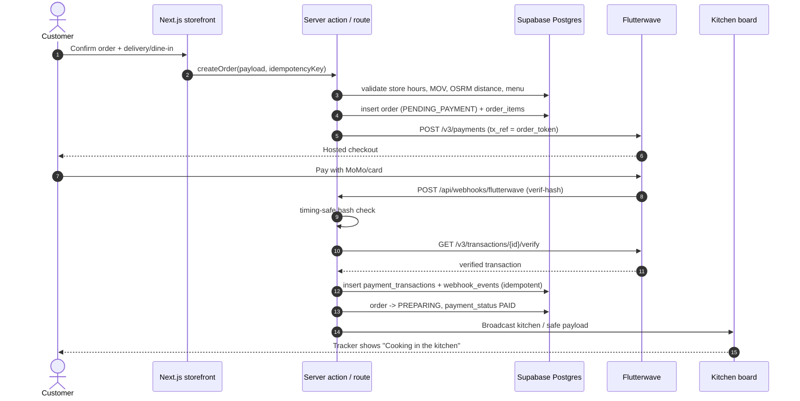
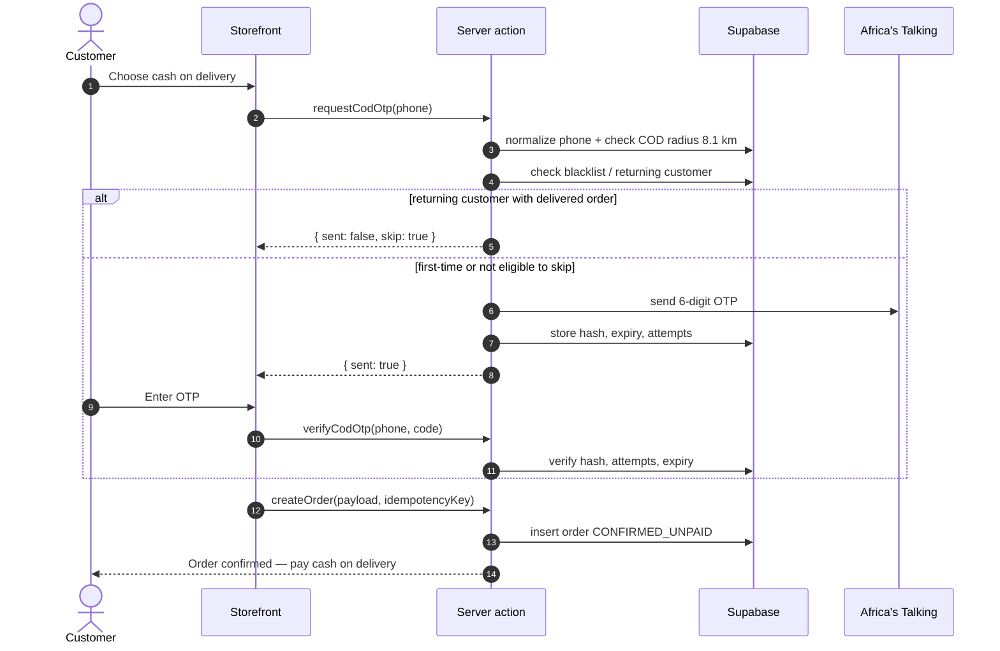
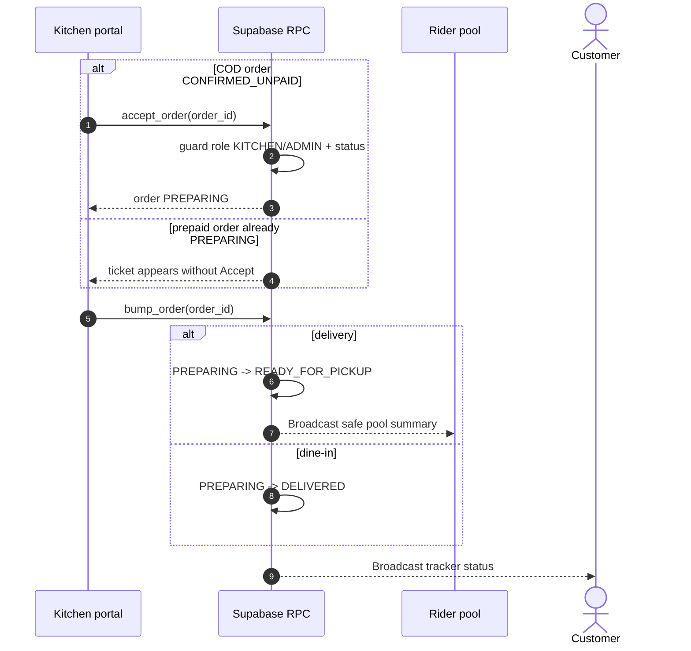
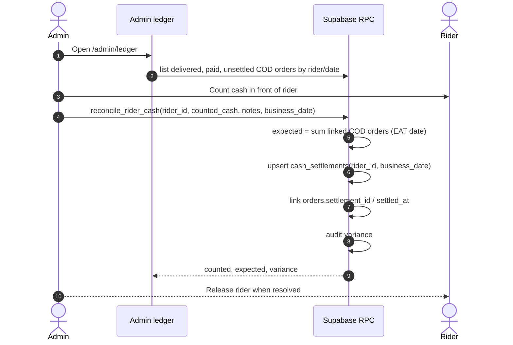
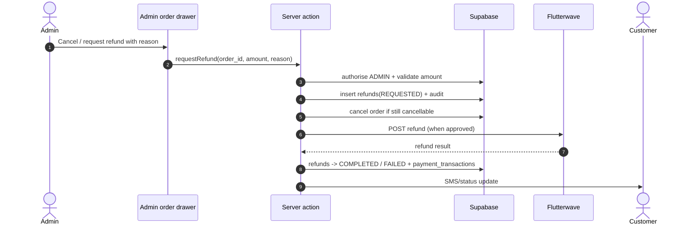

# SEQUENCE DIAGRAMS — Payment, Kitchen, Claim, Settlement, Refund

| Field | Value |
| :--- | :--- |
| **Status** | Normative v1.2 |
| **Version** | 1.2.0 |
| **Date** | 2026-11-09 |
| **Related** | `API_CONTRACTS.md`, `STATE_MACHINES_AND_BUSINESS_RULES.md`, migration RPCs |

These diagrams close the P2 “no sequence diagrams” finding. Mermaid renders on GitHub and in most Markdown viewers. The diagrams are explanatory; the RPC signatures and state transitions in the migration/API contracts remain authoritative.

---

## 1. Prepaid checkout and verified webhook



Rules:

- A redirect alone never marks an order paid.
- A replayed webhook is acknowledged but does not double-apply.
- If verification fails, the order stays `PENDING_PAYMENT`; support investigates.
- Prepaid orders enter `PREPARING` directly; the kitchen does not “accept” them.

---

## 2. COD checkout and OTP



Rules:

- COD is blocked beyond 8.1 km (test/seed ceiling) and when the store is closed.
- OTP failure never silently skips verification.
- The order stays `CONFIRMED_UNPAID` until a rider completes the PIN-verified handover.

---

## 3. Kitchen accept and bump



Rules:

- `accept_order` only accepts `CONFIRMED_UNPAID`; it rejects prepaid and already-accepted orders.
- `bump_order` sends delivery to `READY_FOR_PICKUP` and dine-in directly to `DELIVERED`.
- Kitchen cannot edit prices, refunds, settlements, or delivery data.

---

## 4. Rider claim, delivery, and PIN handover

```mermaid
sequenceDiagram
    autonumber
    actor R as Rider
    participant APP as Rider portal
    participant DB as Supabase RPC
    participant T as Customer tracker

    R->>APP: Open pool
    APP->>DB: get_rider_pool()
    DB-->>APP: area, distance, total only (no PII/PIN)
    R->>APP: Claim
    APP->>DB: claim_order_atomic(order_id)
    DB->>DB: auth.uid() + no active order + READY_FOR_PICKUP
    DB-->>APP: order CLAIMED, rider assigned
    R->>APP: Start trip
    APP->>DB: start_delivery(order_id)
    DB->>DB: CLAIMED -> OUT_FOR_DELIVERY
    loop while OUT_FOR_DELIVERY
        APP->>DB: update_rider_telemetry(order_id, lat, lng, heading)
        DB-->>T: safe latest position (poll/Broadcast)
    end
    R->>APP: Enter customer 4-digit PIN
    APP->>DB: verify_delivery_pin(order_id, pin, lat, lng, ip_hash, ua)
    alt valid, in geofence, attempts remain
        DB->>DB: order DELIVERED; COD -> PAID
        DB-->>APP: { ok: true }
    else invalid / locked / too far
        DB-->>APP: { ok: false, code }
    end
```

Rules:

- `claim_order_atomic` derives the rider from `auth.uid()` and uses a partial unique index to prevent double claims.
- One active order per rider; no next-job queue.
- The rider pool never includes phone, exact address, notes, or handover PIN.
- The PIN is entered in front of the customer; the customer checks the safety seal first.

---

## 5. Cash settlement



Rules:

- Expected cash is the sum of `DELIVERED` + `PAID` COD orders for the EAT business date.
- A second reconciliation for the same rider/date updates the same settlement; it does not duplicate.
- Any variance requires a note and admin review before releasing the rider.
- The ledger must show order IDs, not just a lump sum.

---

## 6. Refund and cancellation



Rules:

- Refunds are never silent; the admin reason and actor are audited.
- A refund cannot exceed the captured amount.
- Provider failure leaves the refund `FAILED` and visible for retry; it never fakes success.
- Cash refunds follow the documented process and are recorded in the settlement/ledger.

---

## 7. Store-closed block

```mermaid
sequenceDiagram
    autonumber
    actor C as Customer
    participant UI as Storefront
    participant API as Checkout action
    participant DB as Supabase settings

    C->>UI: Open checkout
    UI->>API: getStoreStatus()
    API->>DB: read is_store_open + EAT opening/closing hours
    alt closed
        API-->>UI: CLOSED + opening hours + WhatsApp
        UI-->>C: Closed screen; checkout disabled
    else open
        API-->>UI: OPEN
        UI-->>C: Checkout allowed
    end
```

Rules:

- The server re-checks store status at order creation; a stale client cannot bypass it.
- Admin override is explicit and audited.
- Pre-orders/scheduling are deferred in v1.

---

## 8. Revision history

| Version | Date | Change |
| :--- | :--- | :--- |
| 1.2.0 | 2026-11-09 | Created; closes the P2 “no sequence diagrams” finding. |
